<div align="center">


# Xemo

**The gateway to the institutional blockchain ecosystem.**
One prompt in, a live business out.

[Live app](https://xemo-ship.vercel.app) ·
[Economics ledger](https://xemo-ship.vercel.app/dashboard) ·
[Agent discovery](https://xemo-ship.vercel.app/api/capabilities) ·
[Architecture](docs/architecture.md) ·
[Setup](docs/setup.md)


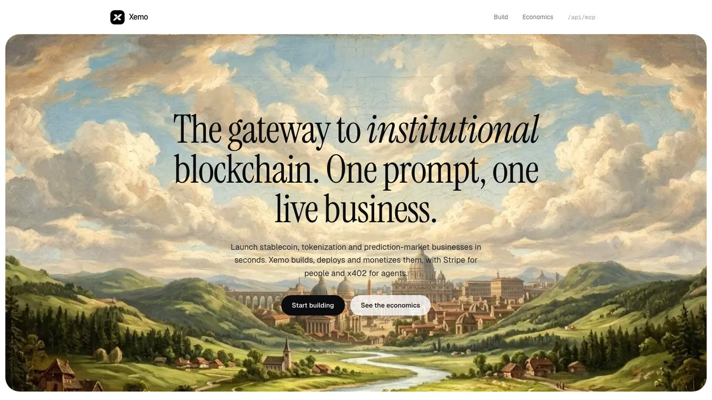

</div>

---

## Contents

- [What Xemo is](#what-xemo-is)
- [Why this is not another prompt-to-app demo](#why-this-is-not-another-prompt-to-app-demo)
- [See it working](#see-it-working)
- [How a build works](#how-a-build-works)
- [Architecture](#architecture)
- [Sequence diagrams](#sequence-diagrams)
- [Build lifecycle](#build-lifecycle)
- [Data model](#data-model)
- [The economics ledger](#the-economics-ledger)
- [The generated app](#the-generated-app)
- [API reference](#api-reference)
- [The PayBox plugin](#the-paybox-plugin)
- [Stripe Projects and CreateOS](#stripe-projects-and-createos)
- [Quick start](#quick-start)
- [Configuration](#configuration)
- [Deploying to Vercel](#deploying-to-vercel)
- [Testing](#testing)
- [Security model](#security-model)
- [Project structure](#project-structure)
- [Tech stack](#tech-stack)
- [Known limitations](#known-limitations)
- [Project history](#project-history)
- [Docs](#docs)

---

## What Xemo is

Xemo launches small paid products for the **onchain economy**: stablecoin reserve risk
checkers, real-world-asset tokenization readiness scorers, prediction-market resolution
auditors, and similar tools for treasuries, issuers, funds, market makers and compliance
teams.

You describe a product in one prompt. An agent then:

1. **plans** it as a structured specification (name, positioning, deliverable fields, price),
2. **generates** a working storefront from a reviewed template,
3. **tests** it inside a [CreateOS](https://createos.sh) Firecracker microVM (install, typecheck, a real server boot and assertions),
4. **deploys** it to a public HTTPS URL,
5. **opens two payment rails** on the finished app:
   Stripe Checkout for **people** and an [x402](https://x402.org) pay-per-call endpoint for **AI agents**,
6. **books every cent** of revenue and cost into one ledger, so each app reports its own gross margin.

It is submitted to two hackathons as two faces of one engine:

| Submission | What it is |
| --- | --- |
| **CreateOS × Stripe Projects** | An agent that writes code, executes and tests it in a CreateOS sandbox, deploys it, and takes Stripe payments. CreateOS is provisioned through Stripe Projects. |
| **PayBox Chapter 1** | A PayBox marketplace plugin whose tools front an x402-gated build service, so any PayBox-connected agent can commission, pay for and inspect a business. |

## Why this is not another prompt-to-app demo

Code generation is table stakes. Three things are different:

**1. Every app is an x402 seller, not just a Stripe seller.** Each generated app ships
with a branded human storefront *and* a machine-readable agent endpoint plus
`/.well-known/x402` terms. One prompt creates a business with two customer types on day zero.

**2. The economics are the product.** Revenue is split into human (Stripe) and agent (x402).
Cost is split into inference and metered sandbox compute. Inference cost is computed from
the token usage the provider actually reports against a real rate card, and compute from
real sandbox seconds. The margin on the dashboard is measured, never estimated.

**3. Xemo sells itself the same way it teaches its apps to sell.** The build service is
itself an x402 resource. An agent with a wallet can buy a business and be its first customer.

## See it working

<table>
<tr>
<td width="50%">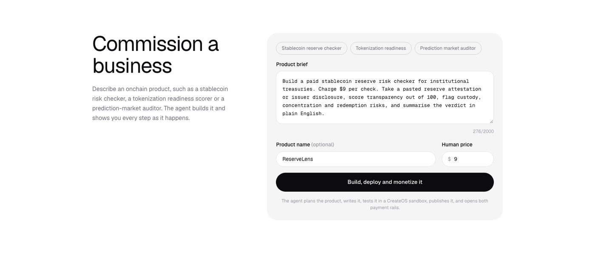<br/><sub><b>Commission.</b> Pick an onchain brief or write your own.</sub></td>
<td width="50%">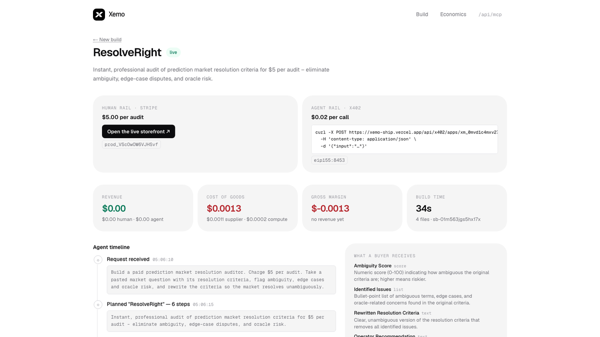<br/><sub><b>Build.</b> A live timeline of every real step, cost and file.</sub></td>
</tr>
<tr>
<td width="50%">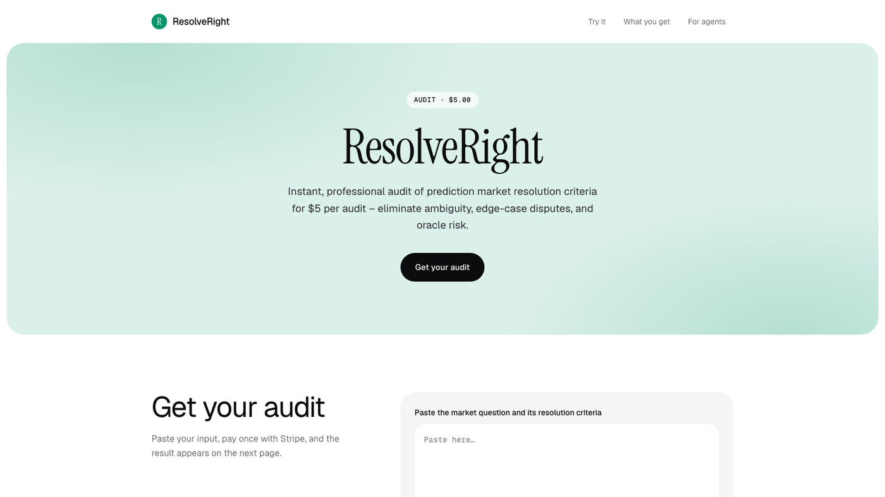<br/><sub><b>Ship.</b> A generated app, live on a CreateOS public URL.</sub></td>
<td width="50%">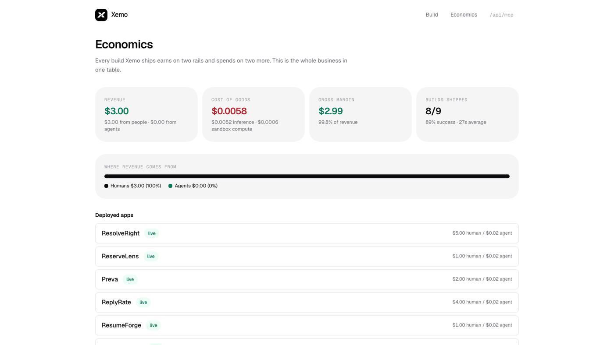<br/><sub><b>Measure.</b> Revenue by rail, cost of goods and gross margin.</sub></td>
</tr>
</table>

There is **no simulated mode**. Every rail is real, and a missing credential fails the
request with a message naming the exact variable rather than producing a number nobody
should trust.

---

## How a build works

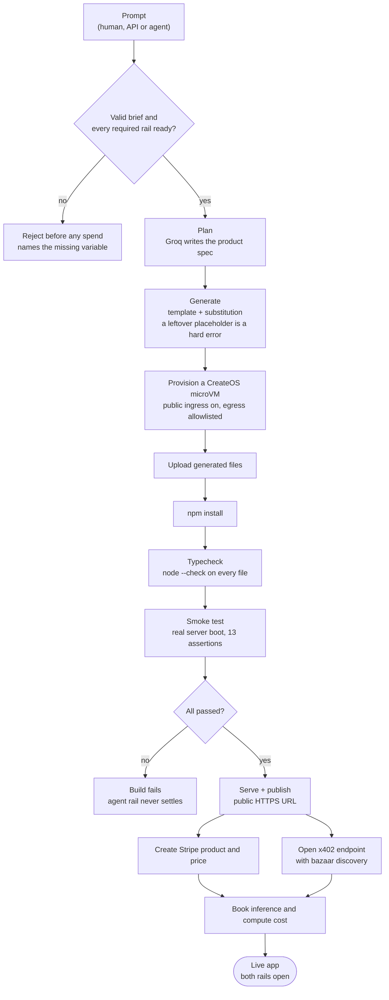

The agent never composes a shell command. It runs a **fixed, named step list**
(`install`, `typecheck`, `test`), so prompt text cannot reach a shell even inside the
disposable microVM.

---

## Architecture

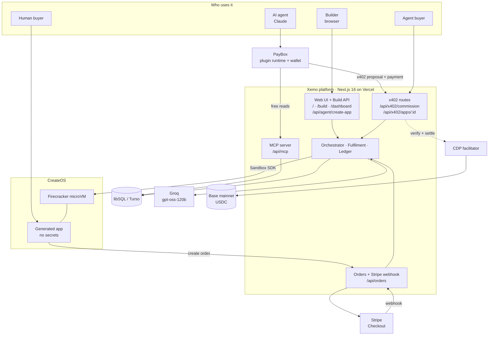

**The platform is merchant of record.** Generated apps hold **no API keys**. They are
storefronts: they post buyer input to the platform, and the platform captures payment,
runs inference and writes the ledger. That is why a generated app can be zero-dependency
(a deploy cannot fail on `npm install`), why no credential ever reaches model-written
code, and why there is exactly one x402 resource server in the system.

### Components

| Component | Responsibility | Where |
| --- | --- | --- |
| Orchestrator | Runs the build pipeline, records every step as an event | `src/lib/agent/orchestrator.ts` |
| Planner | Turns a brief into a validated product spec (Groq, structured output) | `src/lib/agent/planner.ts`, `spec.ts` |
| Codegen | Renders the template, fails on any leftover `{{PLACEHOLDER}}` | `src/lib/agent/codegen.ts` |
| Fulfilment | Produces a purchased deliverable from buyer input | `src/lib/agent/fulfil.ts` |
| Sandbox runner | Provisions, executes in and publishes from a CreateOS microVM | `src/lib/createos/sandbox-runner.ts` |
| x402 server | One resource server, CDP facilitator for Base mainnet | `src/lib/x402/server.ts` |
| Ledger | Idempotent revenue and cost bookkeeping | `src/lib/ledger.ts`, `pricing.ts` |
| MCP tools | Read-only quote, status and listing tools | `src/lib/mcp/tools.ts` |
| Readiness | Reports which rails are wired, blocks builds if required ones are not | `src/lib/env.ts` |

---

## Sequence diagrams

### 1. A human commissions a build from the dashboard

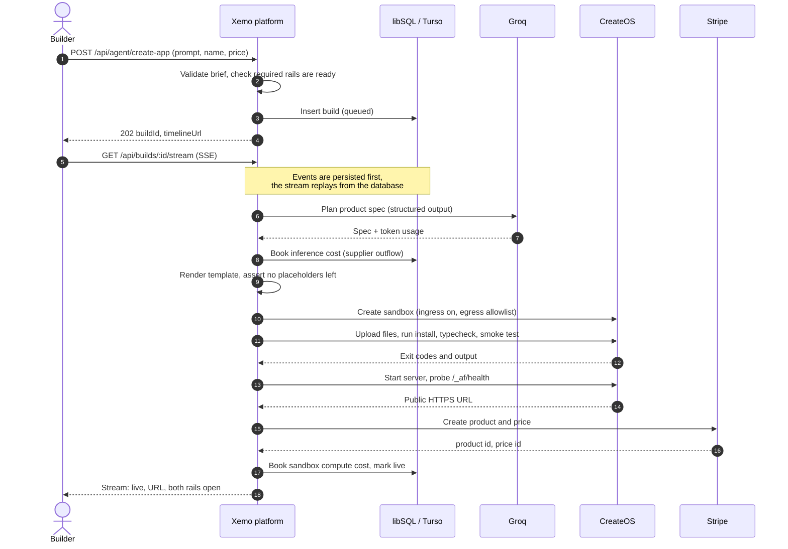

### 2. An agent commissions a build over x402 through PayBox

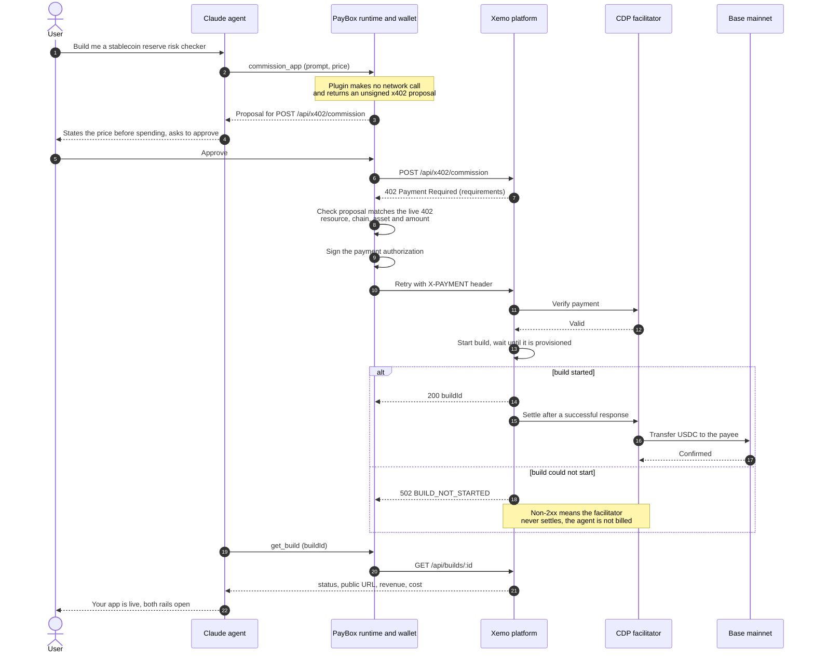

### 3. A human buys from a generated app (Stripe rail)

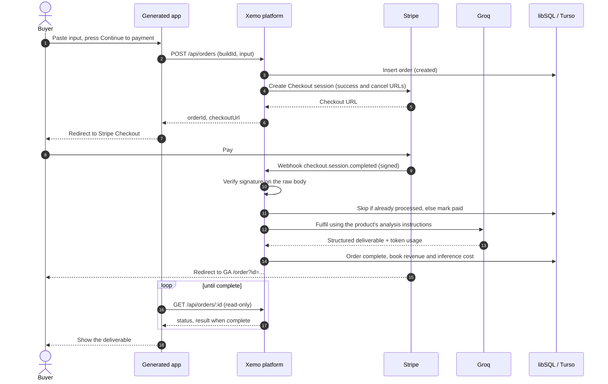

### 4. An agent buys from a generated app (x402 rail)

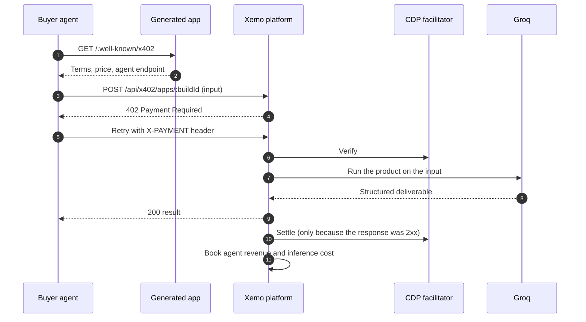

---

## Build lifecycle

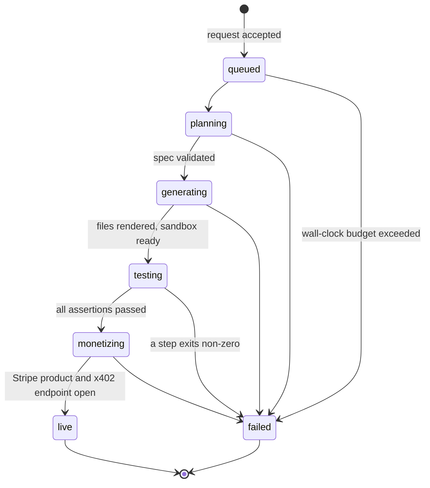

An order, separately, moves through `created → paid → fulfilling → complete` (or `failed`).
It only becomes `complete` through the verified webhook, so a deliverable cannot be
obtained without paying.

---

## Data model

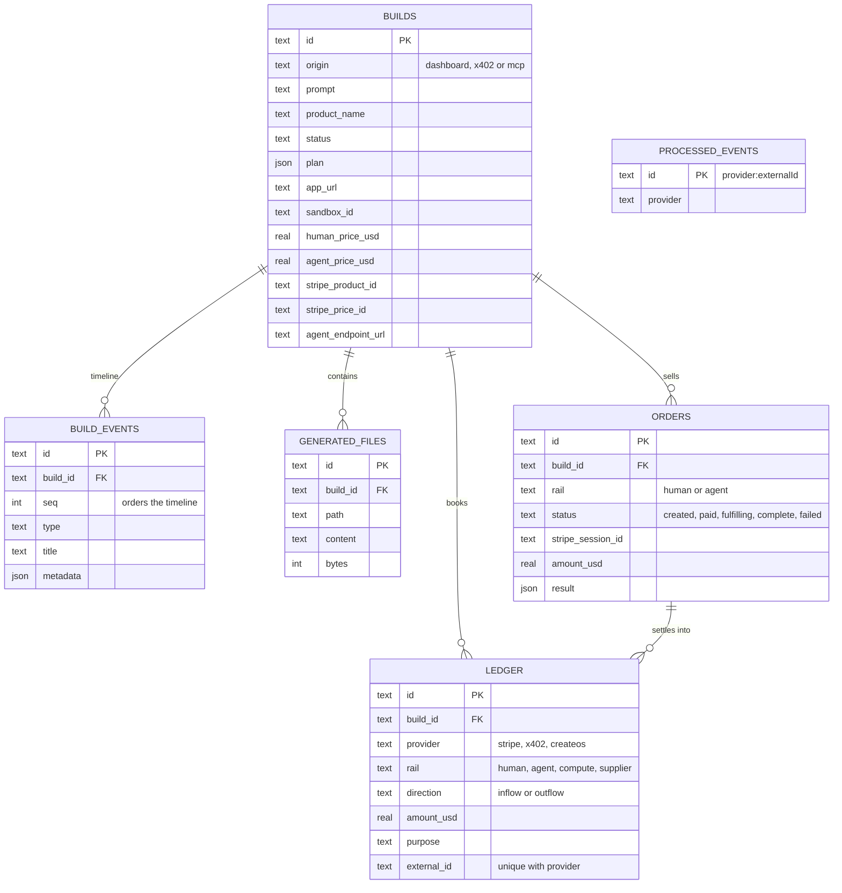

The schema is applied as idempotent `CREATE TABLE IF NOT EXISTS` DDL at server start
(`src/instrumentation.ts`), so there is no migration command to forget. The ledger carries
a unique index on `(provider, external_id)`, which is what makes Stripe webhook replays
and x402 retries safe without racy application-level de-duplication.

---

## The economics ledger

Every dollar in and every cent out lands in the `ledger` table.

| Flow | Provider | How it is measured |
| --- | --- | --- |
| Revenue, humans | Stripe | Settled `checkout.session.completed`, signature verified |
| Revenue, agents | x402 | Settled payment on the agent rail |
| Cost, inference | Groq | Provider-reported token usage times a real rate card (`src/lib/pricing.ts`) |
| Cost, compute | CreateOS | Real sandbox seconds against the published vCPU and GiB rates |

A model that is missing from the rate card **throws** instead of being assigned a plausible
price. A dashboard that invents its own cost basis is worse than no dashboard.

Typical numbers from real runs: a build costs about **$0.001** of inference plus about
**$0.0002** of sandbox compute, and takes roughly **10 s** locally and **30–60 s** on Vercel.

---

## The generated app

Each build ships a small, zero-dependency Node service (`templates/analyzer/`).

| Route | Purpose |
| --- | --- |
| `GET /` | Branded storefront: hero, input form, what the buyer receives, agent section |
| `POST /api/order` | Creates an order on the platform and returns a Stripe Checkout URL |
| `GET /order?id=` | Result page that polls until the verified webhook completes the order |
| `GET /api/order/:id` | Read-only order status (proxied from the platform) |
| `GET /.well-known/x402` | Machine-readable terms so an agent can price the service before calling it |
| `POST /api/agent/analyze` | Answers `402` and points to the paid platform resource |
| `GET /_af/health` | Liveness probe used by the deploy step |

The template is rendered from the spec by substitution. The product name, positioning,
deliverable fields, fulfilment prompt and accent colour are generated. The skeleton is fixed
and reviewed, so a model never writes a server from scratch. Every generated app runs
**13 in-sandbox assertions** against a real server boot before it is published.

---

## API reference

| Method and path | Auth | Purpose |
| --- | --- | --- |
| `POST /api/agent/create-app` | none | Start a build from a prompt. Returns `202` with a `buildId` |
| `GET /api/builds` | none | Public catalogue of deployed apps |
| `GET /api/builds/:id` | none | One build: status, URLs, spec, economics |
| `GET /api/builds/:id/stream` | none | Server-sent events for the live timeline (resumable with `?after=N`) |
| `POST /api/x402/commission` | **x402** | An agent buys a build. Body: `prompt`, optional `productName`, `priceUsd`, `wait` |
| `POST /api/x402/apps/:buildId` | **x402** | An agent buys one call to a generated app |
| `POST /api/orders` | none | A generated app opens a human order, returns a Stripe Checkout URL |
| `GET /api/orders/:id` | none | Read-only order status and result |
| `POST /api/stripe/webhook` | Stripe signature | Settles human payments |
| `POST /api/mcp` | none | JSON-RPC MCP server: `quote_app_build`, `get_build`, `list_apps` (read-only) |
| `GET /api/capabilities` | none | Which rails are ready, network, prices |

**`wait` on commission.** By default the request waits for the build to finish. With
`"wait": false`, the response returns as soon as the build is *provisioned* (the work then
finishes in the background). If the build cannot even start, the route answers `502
BUILD_NOT_STARTED`, a non-2xx, so the payment is **not settled**.

An unpaid `POST /api/x402/commission` returns:

```http
HTTP/2 402
PAYMENT-REQUIRED: <base64 payment requirements>
```

Both x402 routes carry the **bazaar** discovery extension, so each is indexable once a
payment settles through a facilitator that indexes it. There is nothing to submit.

---

## The PayBox plugin

`paybox-plugin/` is a **hosted PayBox marketplace plugin**: a standard TypeScript MCP server
bundled into a single `dist/plugin.mjs`, which PayBox runs in its own sandbox. It is built on
the official starter (v1.0.2) with its pinned toolchain and conformance harness.

| Tool | Network | What it does |
| --- | --- | --- |
| `commission_app` | **No** | Returns an unsigned x402 proposal for `POST /api/x402/commission` on Base. Spends nothing itself |
| `get_build` | Yes | Status, public URL, agent endpoint, revenue and cost. Free |
| `list_apps` | Yes | Everything Xemo has deployed, newest first. Free |

**Payment authority stays with PayBox.** The plugin never spends. It hands back a proposal,
and PayBox validates it field by field against the live `402` (resource, chain, asset,
amount), then the user's wallet signs. The tool description tells the agent to state the
price first and warns that calling it twice is paying twice.

### Set it up in the PayBox portal

1. Build the bundle:
   ```bash
   cd paybox-plugin
   pnpm install
   pnpm build      # dist/plugin.mjs
   pnpm test       # conformance: deterministic double build, schema, tool discovery
   ```
2. Upload `dist/plugin.mjs` in the PayBox developer portal.
3. Under **Variables**, set `XEMO_API_URL` to your deployment origin, for example
   `https://xemo-ship.vercel.app`.
4. Under **Network access**, allow that hostname (needed by `get_build` and `list_apps`).
5. Run the sample call for each tool in the **Test** tab, then **Submit Project**.
6. Enable Xemo under *Unofficial plugins*, and start a **new** chat so the tools load.

A real payment needs USDC on **Base** in the PayBox wallet. PayBox accepts x402 proposals
only on Base mainnet or Solana mainnet, never on a testnet. See [`docs/paybox.md`](docs/paybox.md).

---

## Stripe Projects and CreateOS

CreateOS is provisioned through [Stripe Projects](https://projects.dev), and the shareable
project state is committed in [`.projects/`](.projects/).

```bash
stripe plugin install projects
stripe projects init xemo --skip-skills
stripe projects add createos/project       # Free plan
stripe projects share                      # prints the Stack URL
```

Generated apps run on CreateOS sandboxes through the
[`@nodeops-createos/sandbox`](https://www.npmjs.com/package/@nodeops-createos/sandbox) SDK.
Each build uses a public ingress URL rather than a repo-based deploy, so there is no GitHub
repo per build and no remote build queue. The runner reclaims capacity to stay inside the
plan's concurrent-sandbox cap.

---

## Quick start

**Requirements:** Node 20+, pnpm, and credentials for the rails below. There is no mock mode.

```bash
pnpm install
cp .env.example .env.local     # fill it in, see Configuration
pnpm dev                       # http://localhost:3000
```

The home page and `/api/capabilities` report which rails are ready. Builds refuse to start
until the required ones are, and the error names the variables to set.
[`docs/setup.md`](docs/setup.md) is the credential checklist, in order.

For local Stripe webhooks:

```bash
stripe listen --forward-to localhost:3000/api/stripe/webhook   # prints the whsec_ secret
```

## Configuration

| Variable | Required | Purpose |
| --- | --- | --- |
| `NEXT_PUBLIC_APP_URL` | yes | Public origin. Generated apps and x402 requirements are built from it |
| `DATABASE_URL` | yes | `./data/xemo.db` locally, or a `libsql://` Turso URL (required on Vercel) |
| `DATABASE_AUTH_TOKEN` | with Turso | Turso auth token |
| `GROQ_API_KEY` | yes | Planner and fulfilment model |
| `XEMO_MODEL` | no | Defaults to `openai/gpt-oss-120b`. Must be listed in `src/lib/pricing.ts` |
| `CREATEOS_SANDBOX_API_KEY` | yes | CreateOS Sandbox API key |
| `CREATEOS_SHAPE` / `CREATEOS_ROOTFS` | no | Defaults `s-1vcpu-1gb` and `devbox:1` (has Node) |
| `CREATEOS_MAX_CONCURRENT_SANDBOXES` | no | Your plan's cap (Free 1, Beginner 5, Pro 20) |
| `STRIPE_SECRET_KEY` | yes | Human rail |
| `STRIPE_WEBHOOK_SECRET` | yes | Without it the webhook refuses payloads |
| `X402_PAY_TO` | yes | Address payments settle to. Unset means the x402 routes answer `503` |
| `X402_NETWORK` | no | `eip155:8453` (Base mainnet) for PayBox. Defaults to Base Sepolia |
| `CDP_API_KEY_ID` / `CDP_API_KEY_SECRET` | mainnet | Coinbase CDP facilitator credentials. The public facilitator is testnet only |
| `X402_COMMISSION_PRICE_USD` | no | Price of one build (default `0.50`, the live deployment uses `0.05`) |
| `X402_GENERATED_APP_PRICE_USD` | no | Price of one call to a generated app (default `0.02`) |
| `LIMIT_BUILD_TIMEOUT_MS` | no | Wall-clock budget per build (default 10 minutes) |

Secrets live in `.env.local` (gitignored). Nothing in this repository contains a credential.

## Deploying to Vercel

Xemo runs on Vercel with a remote libSQL database, because the Vercel filesystem is
ephemeral.

1. Create a Turso database and set `DATABASE_URL` and `DATABASE_AUTH_TOKEN`.
2. Import the repo. `vercel.json` pins the project to the single Next.js app.
3. Set the environment variables above, with `NEXT_PUBLIC_APP_URL` set to the production URL.
4. Add a Stripe webhook endpoint at `https://<your-url>/api/stripe/webhook` for
   `checkout.session.completed` and `checkout.session.expired`.
5. Background work after the response uses `after()`, and the timeline stream polls the
   database, so it works across serverless instances.

`pnpm set-url` and `scripts/vercel-env.mjs` help sync URLs and build an env import file
without printing secret values. Full guide: [`docs/vercel.md`](docs/vercel.md).

## Testing

```bash
pnpm typecheck
pnpm template:check      # renders the template, installs, typechecks, runs its 13 assertions
pnpm smoke               # 33 platform assertions over real HTTP
BASE=https://your-deployment pnpm smoke
pnpm createos:check      # provision a real sandbox and boot a generated app
cd paybox-plugin && pnpm test   # PayBox conformance
```

---

## Security model

- **No shell from prompt text.** The agent runs a fixed named step list. Generated code only
  ever executes inside a Firecracker microVM.
- **Deny-by-default egress** in the sandbox: npm, the platform, and little else.
- **Generated apps hold no secrets.** Sandbox environment is declared at create time and
  cannot gain keys at exec time.
- **Pay to receive.** An order becomes `complete` only through the verified webhook, and
  order polling is read-only.
- **Stripe webhook** verifies the signature against the **raw** body and refuses outright
  when no signing secret is configured. Replays post nothing and re-fulfil nothing
  (unique `(provider, external_id)` index).
- **A failed build is not a charge.** x402 settlement happens only after a `< 400` response,
  so a build that cannot ship never settles.
- **Fail loudly, fast.** A misconfigured facilitator answers in milliseconds naming the
  variable to set, so an agent that is waiting to pay is never left hanging.
- **Hard budgets** per build: wall-clock timeout and a per-build supplier spend cap.
- **Quote before spend.** The PayBox tool instructs agents to state the price first.

---

## Project structure

```text
xemo/
├── src/
│   ├── app/
│   │   ├── page.tsx                    landing + commission form
│   │   ├── build/[buildId]/            live timeline page
│   │   ├── dashboard/                  economics ledger
│   │   └── api/
│   │       ├── agent/create-app/       start a build
│   │       ├── builds/                 catalogue, detail, SSE stream
│   │       ├── orders/                 human orders
│   │       ├── stripe/webhook/         settle human payments
│   │       ├── x402/commission/        agents buy a build
│   │       ├── x402/apps/[buildId]/    agents buy from an app
│   │       ├── mcp/                    read-only MCP server
│   │       └── capabilities/           rail readiness
│   ├── components/                     PromptForm, BuildTimeline, ui
│   └── lib/
│       ├── agent/                      orchestrator, planner, codegen, fulfil, spec
│       ├── createos/                   sandbox runner
│       ├── x402/                       resource server + facilitator
│       ├── stripe/                     client, products, checkout
│       ├── db/                         libSQL client, schema, DDL
│       ├── mcp/                        tool definitions
│       ├── ledger.ts · pricing.ts · events.ts · env.ts
├── templates/analyzer/                 the generated app (server, smoke test, README)
├── paybox-plugin/                      PayBox hosted plugin (TypeScript MCP server)
├── scripts/                            smoke, template, createos, x402 and env helpers
├── docs/                               setup, architecture, PayBox, Vercel, demo script
└── .projects/                          Stripe Projects state (CreateOS)
```

## Tech stack

Next.js 16 (App Router, Turbopack) · TypeScript · Tailwind CSS 4 · Drizzle ORM over libSQL
(local file or Turso) · AI SDK 7 with Groq (`openai/gpt-oss-120b`) · `@x402/next` 2.28 with
the bazaar extension and the Coinbase CDP facilitator · `@nodeops-createos/sandbox` ·
Stripe (Checkout, webhooks) · MCP over streamable HTTP · Geist and Instrument Serif.

## Known limitations

Stated plainly, because a demo that hides these is worse than one that admits them.

- **One template family.** The skeleton is fixed (pasted text in, structured deliverable
  out). The product, branding, output shape and fulfilment prompt are generated. Briefs that
  ask for uploads, accounts or multi-step flows are reduced to what is actually built.
- **Agent rail price is per platform, not per build.** The x402 gateway advertises one price
  for all generated apps, so a per-build override would misquote it.
- **Stripe is in test mode** in the live deployment. Human revenue shown is test-mode.
- **Bazaar listing follows settlement.** A resource is indexed after a payment settles
  through a facilitator that indexes bazaar metadata.
- **CreateOS Free plan runs one concurrent sandbox**, and paused boxes still count against
  the cap, so concurrent builds reclaim each other's slots. Set
  `CREATEOS_MAX_CONCURRENT_SANDBOXES` to your plan's real limit.
- **Every rail is mandatory.** There is deliberately no offline or demo mode, so the app
  cannot be exercised end to end without real credentials for the model, CreateOS, Stripe
  and an x402 payee.

## Project history

The core engine (planner, orchestrator, sandbox runner, ledger, both payment rails and the
PayBox plugin) was built during the **PayBox Chapter 1** window, October 16–17, 2026. Work done
after that, including Stripe Projects provisioning of CreateOS, the visual redesign of the
platform and of generated apps, the institutional-blockchain positioning, and the logo, is
visible in the commit history with its real timestamps (`git log`).

## Docs

- [`docs/setup.md`](docs/setup.md): the credential checklist, in order
- [`docs/architecture.md`](docs/architecture.md): why these choices, and what was rejected
- [`docs/paybox.md`](docs/paybox.md): what PayBox does here and how to ship the plugin
- [`docs/vercel.md`](docs/vercel.md): deploying to Vercel with Turso
- [`docs/demo-script.md`](docs/demo-script.md): both demo runs, shot by shot
- [`docs/submission-checklist.md`](docs/submission-checklist.md): what is done and what needs an account

## License

[MIT](LICENSE)
